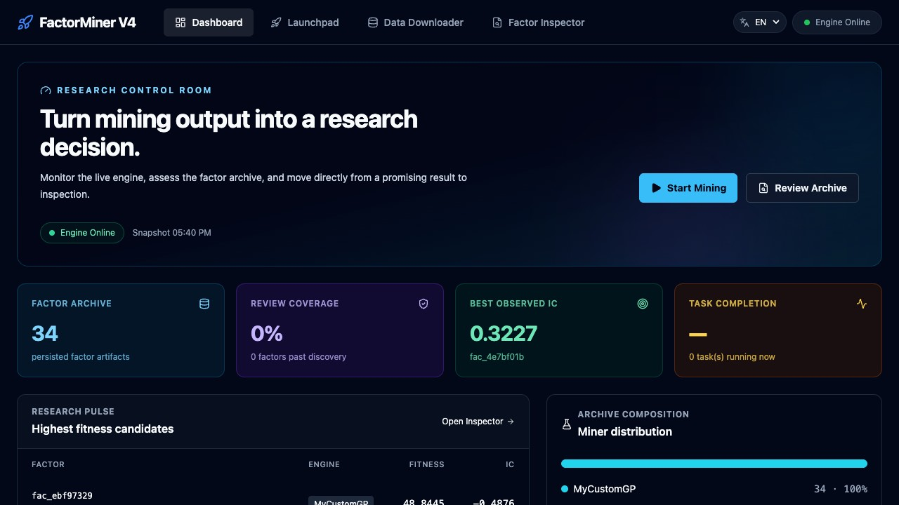
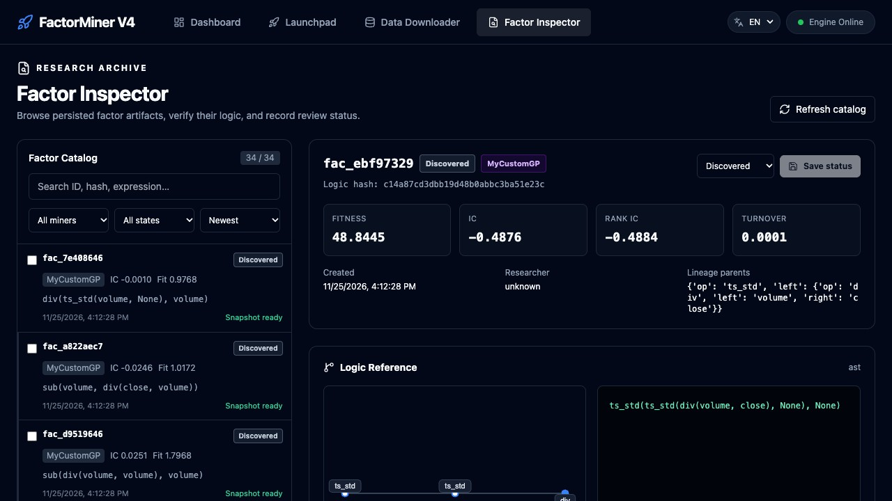

# FactorMiner — Quantitative Factor Mining Platform (V4)

[简体中文](README.zh-CN.md) · [English documentation](docs/README.en.md)

[](https://www.python.org/)
[](LICENSE)
[]()
[](https://github.com/CharlesJ-ABu/FactorMiner)

> **Project status:** V4 is a local, single-user factor research workbench, run from a source checkout.
> 👨‍💻 **Maintainer:** [@CharlesJ-ABu](https://github.com/CharlesJ-ABu)
> **Last updated:** November 25, 2026

FactorMiner is a local Python workbench for discovering, evaluating, and comparing quantitative factors on historical crypto market data. You can run experiments from the command line or use the FastAPI and React interface to launch a run and inspect its results. The same configuration-driven engine serves both interfaces.

The user workspace lets you extend four mining methods: genetic programming, reinforcement learning, neural networks, and language-model-generated code. Follow a candidate from input data through evaluation and task logs to its archived record. Each record preserves the factor logic, metrics, and origin. Neural factors also store model weights and channel information. The dashboard reads these records, and lifecycle labels let you track which factors you have reviewed.

---

## ✨ V4 Core Features

- 🧬 **Four extensible mining paradigms:** GP, RL, LLM, and NN all produce `FactorExpression` objects. Extend them with custom Miners, operators, and Fitness Hooks in `user_workspace`.
- ⚖️ **Shared evaluation and traceable results:** The evaluator calculates IC, RankIC, Turnover, and fitness. Each factor stores its logic, metrics, and provenance as metadata; NN factors also store weights and channel information.
- 🖥️ **Research workbench and CLI:** Dashboard summarizes actual task and factor records, Launchpad starts and tracks tasks, and Inspector reviews factor logic and lifecycle. The same execution engine is available through the CLI.
- 🧭 **Standalone research Skills:** Turn trading intuition into experiments that can be implemented in any framework. With FactorMiner, continue by generating configurations and user extensions, then reviewing actual results.
- 📡 **Market data and naming conventions:** Read local Feather data, fill gaps, and download market data. Files use `{safe_symbol}-{timeframe}-{trade_type}.feather`; perpetual symbols use CCXT notation, such as `BTC/USDT:USDT`.
- 🛡️ **Known execution limits:** General deduplication uses a source-code MD5 hash; the reference NN also filters candidates by output correlation. Evaluation defaults to 8 threads, configurable from 1–64 through `evaluation.max_workers`, with no more threads than candidates. Ray/Celery distributed backends are not integrated.

---

## 🏗️ V4 Repository Layout

```text
FactorMiner/
├── api/                          # FastAPI: REST, WebSocket, task management, and Dashboard/Inspector APIs
│   ├── main.py
│   └── ws_manager.py
├── core/                         # Research execution engine, independent of the UI
│   ├── cli.py                    # factorminer CLI entry point
│   ├── commands/                 # mine / download / inspect commands
│   ├── inspector/                # Factor review: resolution, metrics (IC/IR/Decay/Quantiles), Rich reports
│   ├── data_feed/                # Feather reads, downloads, gap filling, and naming conventions
│   ├── evaluation/               # Parallel evaluator, metrics, and restricted code execution
│   ├── miner/                    # Expressions, registries, Director, and four paradigm base classes
│   │   └── paradigms/
│   ├── storage/                  # FactorMetadata and local factor record storage
│   └── utils/dynamic_loader.py   # Dynamic loading of user_workspace extensions
├── web/                          # React + Vite research workbench
│   └── src/
│       ├── pages/                # Dashboard, Launchpad, Inspector, Data Center
│       ├── layouts/              # Global navigation and language selector
│       ├── hooks/                # WebSocket and other frontend state logic
│       └── i18n.tsx              # Chinese / English / German dictionaries and context
├── user_workspace/               # User experiments; strategies do not require core changes
│   ├── configs/                  # Reusable mining task configurations
│   ├── custom_miners/            # Custom GP / RL / LLM / NN Miners
│   ├── experiment_tools/         # Optional experiment records, summaries, and test-window reevaluation
│   ├── experiments/              # Raw local experiment records, ignored by Git by default
│   ├── custom_operators/         # Registered time-series or cross-sectional operators
│   └── custom_fitness/           # Registered Fitness Hooks
├── skills/                       # Standalone Agent Skills with optional FactorMiner integration
├── factor_db/                    # Saved factor metadata, optional values, and weights
├── data/                         # Local historical data: {safe_symbol}-{timeframe}-{trade_type}.feather
├── docs/
│   ├── architecture/             # V4 architecture design
│   └── assets/                   # WebUI screenshots used in this README
├── requirements.txt
└── README.md
```

---

## 🚀 Quick Start

See the **[Product Overview and Installation Guide](docs/FactorMiner_Product_Report_EN.md)** for the complete workflow, including a minimal GP configuration to save locally. The current release supports local, single-user operation with one backend process. The CLI/API load from the Python package; `user_workspace/`, the frontend, and examples come from the source checkout. The wheel does not include a complete workspace or a ready-to-run website.

### 1. Prepare the Environment

You need Python ≥3.10 (tested with 3.12) and Node.js ≥22.12. The commands below are for a macOS/Linux shell:

```bash
# Clone the project
git clone https://github.com/CharlesJ-ABu/FactorMiner.git
cd FactorMiner

# Use Python 3.10+; this example uses 3.12
python3.12 -m venv .venv
source .venv/bin/activate

# Install runtime dependencies, the CLI/API, and test dependencies
python -m pip install -e '.[test]'
factorminer --help
```

To run the product without test dependencies, use `python -m pip install -e .`. `requirements.txt` retains the broader extension/research environment; you can install it first, followed by an editable install. Install `.[test]` when you need to run tests. Extensions are responsible for their additional dependencies: the loader scans all extensions, and any module import failure in the full workspace blocks mining. For your first CLI run, use the isolated GP extension directory in the guide. After starting the Web backend, check that `/api/miners` reports an empty `load_errors` list.

### 2. Start the Services (Separate Backend and Frontend)

**Start the backend engine (FastAPI)**
```bash
# Run the backend on port 8000
python -m uvicorn api.main:app --host 127.0.0.1 --port 8000
```

**Start the research workbench (React Web)**

Open another terminal, enter the source root, then run:

```bash
cd web
npm ci
npm run dev -- --host 127.0.0.1 --port 5173 --strictPort
```
Once it starts, open `http://localhost:5173` to use the FactorMiner workbench.

The frontend connects to port 8000 on the local machine. Use `--reload` only for development: code changes restart the backend and clear in-memory tasks. This guide does not establish support for remote deployment, authentication, or multi-tenancy.

**Factor Inspector (Phase II)**

`/inspector` reads factors persisted in `factor_db/metadata/`, independently of task state held in memory and lost on service restart. When archiving a factor, Director saves a `timestamp / asset (if applicable) / factor / forward_return` snapshot aligned with its evaluation slice, along with the trading pair, timeframe, input streams, data range, and forward-return definition.

The detail page uses that snapshot to show actual rolling IC, mean forward returns by quantile, turnover, and data lineage. Sequential single-asset mode uses rolling time-series IC; cross-asset mode uses cross-sectional IC at each timestamp. Charts do not recalculate missing history, fabricate data, or substitute simulated results. In the catalog, select 2–5 factors with existing snapshots to compare rolling IC, or update lifecycle states in bulk. Older records without snapshots explicitly ask you to mine again instead of generating a fictitious Tearsheet.

**Metrics and restart behavior**

The sole metric contract for archived factors is `metrics.IC`, `metrics.RankIC`, `metrics.Turnover`, and `metrics.fitness_score`. The CLI, Launchpad, Dashboard, and Inspector use these original fields, not lowercase aliases. `0` can be a candidate's real score. If an entire new batch scores zero, first confirm that the backend has restarted with the latest Python code and inspect these fields in `factor_db/metadata/<factor_id>.json`. A FastAPI restart clears Tracker task history held in memory, but does not delete factor records or Phase II snapshots in `factor_db`.

**Research Dashboard**

The home page `/` is the research dashboard. It reads task status and `factor_db` records aggregated by `/api/dashboard`, showing engine health, factor inventory and review coverage, the highest-fitness candidates, archived factors by Miner, and recent execution records. Each leading factor links directly to Inspector, and each task entry links to Launchpad. The page does not invent research curves for visual effect.

**Interface language (Chinese / English / German)**

The selector at the top right switches between Simplified Chinese, English, and German. The initial language follows the browser and is saved in local `localStorage`. Global navigation, Research Dashboard, and Factor Inspector are currently covered. Research artifacts—including factor IDs, trading pairs, expressions, source code, model versions, and metric names such as IC / RankIC—remain unchanged so they can be copied and traced reliably.

## 🖥️ Web UI Workbench

The WebUI connects configuration, observable execution, and reviewable artifacts in a research workflow:

- **Research Dashboard** (`/`): Engine health, task success rate, factor inventory, leading factors, and paradigm distribution.
- **Mining Launchpad** (`/launchpad`): Select a paradigm and configuration, start a task, and open live logs and results from Tracker.
- **Factor Inspector** (`/inspector`): Browse persisted factors and review their logic, metrics, provenance, and lifecycle state.
- **Data Center** (`/data`): Check data coverage and download market data.



*Research Dashboard: the actual local English interface, showing tasks, factors, and research quality from the local API using synthetic market data.*



*Factor Inspector: the actual local English interface, showing the factor catalog, reproducible logic, and metric review using synthetic market data.*

### 3. Headless Mode (CLI Mining, Factor Analysis, and Downloads)

Use the CLI from the source root when you do not need the Web interface:

**1. Download historical market data in batches**
The built-in `factorminer download` command provides a direct batch download path:
```bash
# Download spot market data
factorminer download --exchange binance --symbols BTC/USDT,ETH/USDT --timeframes 1d,1h --type spot --start 2023-01-01 --end 2024-01-01

# Download USDT-margined perpetual futures data
factorminer download --exchange binance --symbols BTC/USDT:USDT --timeframes 1m --type futures --start 2024-05-01 --end 2024-05-10
```

Download dates are interpreted as UTC `[start, end)`: the end date is excluded. For example, one day of 1m data should contain 1,440 bars. Each batch continues paging through its end, and completeness is checked against the requested interval before saving, including missing bars at either boundary. A timezone-naive `date` in Feather represents UTC. Older timezone-aware data is converted to UTC before reading, merging, or gap filling, preserving the same instant. Gap filling reuses the original download task's exchange instance, configuration, and market identity. Three consecutive empty responses, repeated old pages, or out-of-range responses produce an incomplete-gap error.

Invalid OHLC values, or NaN and positive/negative Infinity in required OHLCV columns, fail the pre-save health check. `merge` preserves earlier intervals; `overwrite` replaces the file with data from the current interval. Both ordinary and batch downloads first write a unique temporary file, then replace the destination atomically. Validation or write failures preserve the original file and remove the temporary file. Merging accepts the reader's supported `date`, `time`, and millisecond `timestamp` columns and normalizes them to UTC before the health check. Corrupt old files, unrecognized time columns, and missing time columns return errors. The CLI exits with `1` if any requested download combination fails. Web progress is associated with a task ID, with `completed / failed / partial_failed` distinguishing the outcomes; 100% progress alone does not mean success.

Within one process, ordinary and batch downloads share a thread lock keyed by the destination's normalized absolute path. The lock covers reading the old file, merging, health checks, and publishing, so two successful downloads cannot overwrite each other's merged intervals. Each call fixes its exchange, market, and destination path; different files can still be processed concurrently, and failures release the lock. This does not coordinate simultaneous writers across processes or machines.

When the market data reader finds a missing file, automatic downloading uses the configured exchange and market. `mine_period` / `test_period` still include their final bar; internally, these slices are converted to the corresponding half-open UTC download intervals. For example, a 1m slice from 00:00 to 00:19 fetches 20 bars without requesting an additional full day.

Download and mining task states are stored by task ID in the current API process. When the monitoring connection recovers, the latest states are replayed. During disconnection, the download page reports interrupted monitoring without deciding whether the download succeeded or failed. Both kinds of state are cleared by an API restart. Launchpad consumes task states, logs, and scatter points event by event, so consecutive messages are not lost when React batches renders. A late initial HTTP snapshot only adds tasks that have not appeared yet; confirmed `completed / failed / completed_empty` states cannot be overwritten by stale progress.

**2. Run factor mining from the command line**
Use `factorminer mine` to run a task from a JSON configuration. Before running, prepare the local market data required by the configuration and check the full workspace's dependencies:
```bash
# Run built-in GP (genetic programming); generations and parameters come from the config
factorminer mine --miner GP --config user_workspace/configs/demo_config.json

# Run a custom Miner from user_workspace, such as MyCustomGP
factorminer mine --miner MyCustomGP --config user_workspace/configs/config.json --user-dir user_workspace

# Run a custom LLM experiment; API keys come from the environment variables named in the config
factorminer mine --miner MyCustomLLM --config user_workspace/configs/configLLM_experiment.json --user-dir user_workspace

# Run the custom neural-network Miner; --iterations temporarily overrides the configured outer iterations
factorminer mine --miner NN --config user_workspace/configs/configNN.json --user-dir user_workspace --iterations 5
```

**Prediction targets**

All Miners and Inspector share the top-level `target` configuration. When omitted, the backward-compatible target is
`close[t+1] / close[t] - 1`. For example, to enter at the next bar's open and hold through the close of the third bar:

```json
{
  "target": {
    "type": "forward_return",
    "entry_price": "next_open",
    "exit_price": "close",
    "horizon_bars": 3,
    "return_type": "simple"
  }
}
```

Supported entry prices are `current_close` / `next_open`, the exit price is `close`, and return types are `simple` / `log`. Targets are constructed independently within each `mine_period` / `test_period` interval. Samples at the end without enough future data are `NaN` and excluded from evaluation; targets never bridge discontinuous intervals.
When archiving a factor, the normalized `target` and exact formula are written to data lineage. Inspector inherits that target by default when reviewing a factor ID. It is overridden only when `target` is explicitly supplied in the Inspector configuration, with a warning if the definitions differ.
`DL` is a deprecated paradigm name. Old commands and configurations are temporarily mapped to `NN` with a warning; all new configurations, documentation, and interfaces use `NN`.

After mining, the terminal prints the Final Mining Summary, listing all surviving factors and their IC results.

**3. Analyze and review factors from the command line (Factor Inspector)**
Use `factorminer inspect` to review a restorable factor—by Factor ID, AST string, or Python source—on specified pairs and an out-of-sample interval. An NN Factor ID requires a complete portable model artifact, a registered loader, a valid channel, and matching inputs:
```bash
# Inspect an existing factor stored in factor_db
factorminer inspect --factor "fac_dc9b98d8" --pairs "BTC/USDT:USDT"

# Paste an AST expression for review across assets and periods (out-of-sample/OOS validation)
factorminer inspect \
  --ast "{'op': 'ts_mean', 'left': {'op': 'div', 'left': 'close', 'right': 'open'}}" \
  --pairs "BTC/USDT:USDT,ETH/USDT:USDT" \
  --start 2025-08-01 --end 2025-12-31 --timeframe 5m
```
The report includes **valid-data Coverage**, **RankIC (Mean/Std/IR/t-stat)**, **Pearson IC**, default **Lag 1, 2, 3, 5, 10 decay**, **mean forward returns for five quantile groups**, and **factor-value change diagnostics**. IR currently uses a fixed `sqrt(252)` scale, without adjustment for bar frequency or the crypto trading calendar. It is not an annualized-return metric for arbitrary timeframes. The positive-IC share is not a trade win rate, and group means are not strategy equity curves after costs.

CLI rolling RankIC re-ranks observations within the latest 20 jointly valid observations and requires at least 10; overall Spearman still uses the full sample. CLI Inspector loads data one asset at a time, so it currently reevaluates only single-asset NNs with all required inputs. Cross-asset NNs are explicitly rejected. You can supply the full feature matrix required by the model through `FactorResolver`, or view existing snapshots in Web Inspector. Missing artifacts, old bare weights, unknown formats, and missing features are never guessed into a model restoration.

Inspector resolves exchange and market in this order: explicit API arguments → configuration → Binance/futures defaults. Read failures, empty slices, and computation errors appear as `Inspection unavailable` with the reason for that asset; metrics for other successful assets are retained. If any asset fails, the inspect CLI exits with `1`, rather than displaying unavailable metrics as zero.

Reevaluation uses the mining evaluator's axis-alignment and numeric checks: misaligned indexes, nonnumeric values, Infinity, and all-NaN factors are errors. Fewer than the existing minimum of 10 jointly valid observations also makes inspection unavailable. Normal warm-up NaNs, sufficient samples, and genuine zero values retain their meaning. If a user extension fails to import, or an explicitly supplied configuration is missing, unreadable, or not a valid JSON object, inspect exits with `1` before reading market data. Omitting the configuration still allows defaults.

Lag analysis constructs returns independently within each requested interval. It keeps entry/exit/return_type unchanged and changes only the horizon, without taking future prices across interval boundaries. If ties leave too few distinct values for a quantile group, that group and any uncomputable Q5−Q1 spread display `N/A` and return `None`. A group with actual observations and a mean of zero still displays zero. Group returns not yet calculated by the cross-asset metrics entry point are also marked unavailable.

A training result from `MyCustomNN` is not a conventional formula. Training first uses a temporary model group with `channel=-1` to retain the computation graph; after training, the best output channels become individual factors. Each result appears as `NNModel(v=<weights-hash>) [Ch: <n>]` with its own IC/fitness. Portable models are saved to `factor_db/models/`, and channel metadata to `factor_db/metadata/`. In both CLI and Web, `sequential_single` processes configured pairs one by one. Factor lineage records only the asset actually processed, and Web aggregates all results and total progress. An asset with an empty local training slice is skipped with a warning. `cross_asset` still runs once with all assets together. `data_feeds.mining_mode` accepts only these two strings and defaults to `sequential_single` when omitted. Misspellings and incorrect types fail before market data is read or Director is constructed; the same applies when calling the reader directly. If CLI `--iterations` is omitted, `max_iterations` from the configuration is used, or 5 if that is also absent. An explicit CLI argument overrides the configuration.

If the command-line entry point is not installed, replace any CLI example with its equivalent module command:

~~~bash
python -m core.cli mine --miner MyCustomGP --config user_workspace/configs/config.json --user-dir user_workspace
python -m core.cli inspect --factor "fac_dc9b98d8" --pairs "BTC/USDT:USDT"
~~~

---

<a id="custom-miners-operators-and-fitness-hooks"></a>

## 🧪 Custom Miners, Operators, and Fitness Hooks

User extensions live in user_workspace. WebUI dynamically imports Python modules from custom_miners, custom_operators, and custom_fitness when reading the Miner list and starting tasks; the CLI does so when executing commands. Decorators register the implementations in runtime registries.

~~~text
user_workspace/
├── custom_miners/       # The four paradigms or any custom Miner
├── custom_operators/    # Reusable time-series / cross-sectional operators
├── custom_fitness/      # Factor scoring hooks
├── experiment_tools/    # Optional experiment records, summaries, and reevaluation
├── experiments/         # Raw local run evidence, ignored by Git
└── configs/             # Reusable task configurations
~~~

Every paradigm follows the same result contract:

1. initialize_search_space initializes the model, population, or memory.
2. generate_candidates returns a list of executable FactorExpression subclasses.
3. evaluate_candidates delegates to self.evaluator.evaluate(candidates) to obtain EvaluationFeedback.
4. After updating its policy, prompt, or weights, update_model must also place the final selected candidates in self.state.population (or replay_buffer).

Step 4 is essential: updating a model alone does not mean a factor has been discovered. BaseFactorMiner ultimately reads outputs only from population or replay_buffer. Otherwise the task completes normally, but Tracker reports no valid factors to save.

### 1. Customizing the Four Paradigms

| Paradigm | Starting point to copy | Candidate expression | Research artifacts to retain |
| --- | --- | --- | --- |
| GP | user_workspace/custom_miners/my_custom_gp.py | MyGPExpression / FactorExpressionAST | Executable ASTs and the elite population after mutation; the reference implementation does not implement full crossover |
| RL | user_workspace/custom_miners/my_custom_rl.py | MyRLExpression | Action trajectories, updated policy, and replay or elite candidates |
| LLM | user_workspace/custom_miners/my_custom_llm.py | FactorExpressionCode | Generated code, reflection history, and scored code candidates |
| NN | user_workspace/custom_miners/my_custom_nn.py | FactorExpressionTensor | Weights, channel metadata, and factor results for each channel |

Copy and adapt the reference implementation for your paradigm. The following is only an interface skeleton: you must implement `make_expression()`, so it is not directly runnable. Use `my_custom_gp.py` as the runnable GP starting point.

~~~python
from core.miner.paradigms.base import BaseFactorMiner
from core.miner.registry import MinerRegistry


@MinerRegistry.register("MyMomentumGP")
class MyMomentumGPMiner(BaseFactorMiner):
    def initialize_search_space(self):
        self.state.population = []

    def generate_candidates(self):
        # Return instances of your FactorExpression subclass.
        return [self.make_expression()]

    def evaluate_candidates(self, candidates):
        return self.evaluator.evaluate(candidates)

    def update_model(self, candidates, feedback):
        ranked = sorted(
            zip(feedback.metrics, candidates),
            key=lambda item: item[0].get("fitness_score", float("-inf")),
            reverse=True,
        )
        self.state.population = [expr for _, expr in ranked[:20]]
~~~

#### GP: Make the AST Executable

GP candidates are tree expressions. Their compute() method must turn streams such as close, open, and volume into a pandas.Series aligned with the input index. The built-in MyGPExpression demonstrates recursive AST evaluation. When adding a node, implement its evaluation, complexity calculation, and readable source representation together.

~~~python
# Example AST: (close / open) - volume
{
    "op": "sub",
    "left": {"op": "div", "left": "close", "right": "open"},
    "right": "volume",
}
~~~

The reference GP's `update_model` performs selection; subsequent candidate generation performs mutation. Users can add crossover. Selected elite expressions must be written to `state.population`, rather than merely printed in generation logs.

#### RL: Policies and Factors Are Different Artifacts

RL can represent choosing operators, selecting input streams, and stopping generation as actions, and record the trajectory on MyRLExpression. Policy-network weights, rewards, and trajectories are training artifacts; an independently executable expression with metrics is a research artifact. After each policy update, select the Top-K sampled expressions by fitness and retain them in state.population or replay_buffer.

#### LLM: Code Candidates Must Set factor

The LLM paradigm uses FactorExpressionCode. In sequential mode, code receives a pandas DataFrame named `df` and must create a numeric `pandas.Series factor` with the same index as the input and no infinite values:

~~~python
returns = df["close"].pct_change()
factor = returns.rolling(20, min_periods=10).mean()
~~~

In `cross_asset` mode, `df` maps feature names to pandas.DataFrame objects, each with time × asset axes. `factor` must be a DataFrame with exactly the same axes. All LLM code must pass an AST allowlist and run in a separate-process sandbox with wall-clock, CPU, and memory limits. Unsandboxed fallback is not allowed.

Formal factor records persist only the Prompt's SHA-256 digest. Successful and failed results enter bounded Reflection memory, and secrets are removed recursively from candidate provenance before it is written to disk. `MyCustomLLM` stores reflection history separately from high-scoring code candidates: history informs the next prompt, while the Top-K candidates go into `state.population` for Director to archive.

To review the full generation process, set `experiment.record_dir` in the configuration to enable the separate `LLMExperimentRecorder`. Located at `user_workspace/experiment_tools/llm_recorder.py`, the Recorder saves full Prompts, raw responses, candidate code, execution results, Reflection, output hashes, and deterministic replay records. These raw artifacts go into `user_workspace/experiments/`, which Git ignores by default. The Miner remains responsible only for generation, evaluation, and updates; users can replace the Prompt or candidate strategy without modifying the Recorder.

Inject LLM API keys through the environment variables specified by `llm_api_config.keys_env`; do not put them directly into JSON or source code. See the [Custom LLM and Experiment Recording Guide](docs/guides/custom_llm_experiments.en.md) for complete configuration, headless execution, recording, and report-generation examples.

Set evaluation concurrency through `evaluation.max_workers`, which must be a positive integer. Every LLM candidate starts a short-lived sandbox process, so choose concurrency with the machine's memory in mind. For example:

~~~json
{
  "evaluation": {"max_workers": 2},
  "llm_sandbox": {
    "timeout_seconds": 5,
    "cpu_seconds": 3,
    "memory_mb": 1024
  }
}
~~~

#### NN: Turn Trained Weights into Channel Factors

Trained NN weights are not themselves a directly scorable factor. The reference `MyCustomNNMiner` fits a standardizer and NumPy MLP on `mine_period`, materializes hidden-layer channels as individual `FactorExpressionTensor` objects, then ranks them by out-of-sample fitness on `test_period`. Candidates across iterations are filtered by numeric correlation, and the Top-K across the whole run are retained rather than only the last iteration's results.

Models are saved as restorable `factor_db/models/<model_version>.npz` artifacts containing weights, biases, feature order, standardization parameters, data mode, and schema version. Web Inspector can still display metadata for old `.pt` records containing bare weights, but those weights cannot restore a model for CLI reevaluation. New metadata consistently uses `nn_channel / model_version / channel`; historical `dl_channel` records remain readable.

You can edit `user_workspace/custom_miners/my_custom_nn.py` directly or copy it and register a new name. The shared engine requires the final expression to return an index-aligned `Series` for one asset or `DataFrame` for cross-asset data, and the model to provide `predict_channel()`, `clone()`, and `export_artifact()`. When changing the model architecture or storage format, update `model_format`/`schema_version` and register the matching loader through `register_nn_model_loader()` so older models remain reloadable. If you override only the reference Miner's `build_model()` and keep its training loop, the new model must also provide `adapter.prepare()` and `train()`. Replacing the entire training loop removes that internal requirement.

The repository also includes the advanced learning template `MyTemporalNN`:

- It uses only current and past data to construct 1/3/5/15/30/60-minute returns, rolling volatility, price/volume z-scores, candle ranges, and cyclical time features.
- Its target is a configurable forward 5-minute return.
- Channel 0 is the direct prediction combination; the other channels are hidden representations with a decorrelation constraint.
- It combines `MSE + Pearson IC Loss` and selects positive-direction signals using signed RankIC.
- The `numpy_temporal_ic_mlp_v1` model format supports full reloading.

A copyable single-asset configuration intended for an approximately 10-minute run is at `user_workspace/configs/configNN_temporal_10min_template.json`. This teaching template does not replace the basic `MyCustomNN` or change GP, RL, or LLM configurations.

### 2. Register and Use Custom Operators

Create a module in user_workspace/custom_operators and register functions through OperatorRegistry. Operators should accept and return index-aligned pandas.Series objects:

~~~python
# user_workspace/custom_operators/robust_ops.py
import pandas as pd
from core.miner.registry import OperatorRegistry


@OperatorRegistry.register(arity=1)
def rolling_zscore(series: pd.Series) -> pd.Series:
    mean = series.rolling(20, min_periods=10).mean()
    std = series.rolling(20, min_periods=10).std().replace(0, pd.NA)
    return (series - mean) / std
~~~

CLI and WebUI load this module when starting a task. GP/RL candidate generators resolve the configuration's allowed operators into shared metadata. An arity=1 operator produces a unary AST node with only left; an arity=2 operator produces a binary node with left/right operands. FactorExpressionAST uses the same runtime dispatcher for built-in and registered operators. Registration, configuration, generation, and evaluation are therefore connected end to end, without further changes to MyGPExpression/MyRLExpression.

~~~python
# Unary node
{"op": "rolling_zscore", "left": "close"}

# Binary node
{"op": "add", "left": "close", "right": "volume"}
~~~

Declare the operators the search may use in the configuration:

~~~json
{
  "search_space": {
    "allowed_operators": ["add", "custom_ts_decay", "rolling_zscore"]
  }
}
~~~

The default MyCustomGP search space now includes basic arithmetic, built-in ts_mean / ts_std, and the user time-series operators custom_ts_decay, ts_zscore_20, ts_delta_5, ts_rank_20, and ts_volatility_20. These cover weighted decay, rolling standardization, short-term changes, rolling percentile position, and rolling volatility. Add or remove them in config.json's search_space.allowed_operators to fit the research question.

`tests/test_cli_smoke.py` uses temporary synthetic Feather data to verify the chain from registration → AST generation → evaluation → fitness → metadata/snapshot persistence. Actual research still requires market data for the assets and intervals in your configuration.

Handle NaN/infinite values produced by rolling windows, and ensure operators return pandas.Series or pandas.DataFrame. Startup validation rejects arity values other than 1/2, insufficient function signatures, unregistered operators, and unknown Miners/Fitness Hooks. Runtime operator exceptions include the operator name rather than silently degrading to a zero factor.

### 3. Register a Custom Fitness Hook

A Fitness Hook receives factor values, forward returns, and the base metrics already calculated by the evaluator. It may return a single score or a dictionary containing fitness_score. Additional metrics in that dictionary are stored with the factor for review in Inspector.

`fitness_score` must be finite. NaN, positive/negative Infinity, or a missing field fails that candidate's evaluation and preserves error feedback; evaluation continues for other candidates. Valid zero scores, negative scores, and additional diagnostic metrics retain their original values in the archive. In HTTP / WebSocket transport, NaN or positive/negative Infinity diagnostic values become JSON `null`, which the existing metric display marks unavailable. The original archive is not rewritten, and unavailable values are not filled with zero.

~~~python
# user_workspace/custom_fitness/turnover_aware.py
from core.miner.registry import EvaluatorRegistry


@EvaluatorRegistry.register_fitness_hook("turnover_aware")
def turnover_aware(factor_values, returns, base_metrics: dict) -> dict:
    ic = float(base_metrics.get("IC", 0.0))
    turnover = float(base_metrics.get("Turnover", 0.0))
    penalty = 0.02 * turnover
    return {
        "fitness_score": abs(ic) * 100 - penalty,
        "turnover_penalty": penalty,
    }
~~~

Merge the following fields into a complete configuration, using the exact registered name. This is a configuration fragment: keep the actual market data intervals and other required fields:

~~~json
{
  "max_iterations": 5,
  "data_feeds": {
    "pairs": ["BTC/USDT:USDT"],
    "timeframe": "1h",
    "required_streams": ["close", "volume"]
  },
  "fitness": {
    "hook": "turnover_aware"
  }
}
~~~

If the Hook name has not been loaded or does not match, startup validation aborts before reading data. Save the Hook to the file above, change the scoring entry in `user_workspace/configs/config.json` to `turnover_aware`, check the market data interval, and verify with a small number of iterations:

~~~bash
factorminer mine --miner MyCustomGP --config user_workspace/configs/config.json --user-dir user_workspace --iterations 1
~~~

### 4. Startup Validation and CLI Smoke Tests

CLI and Launchpad share startup validation. Dynamic import failures, unknown Miners, missing required data streams, invalid operator names/arity, and unknown Fitness Hooks are returned as aggregated errors before startup. A custom Operator must accept the positional arguments required by its declared arity; a Fitness Hook must accept factor_values, returns, and base_metrics.

Dynamic loading follows module registration order, supports dataclasses with postponed annotations, and restores the previous module registration if an import fails. `SystemExit` / `KeyboardInterrupt` likewise trigger cleanup before being propagated unchanged. Computing an AST that references a missing stream produces an explicit error. The numeric terminal `0` represents a constant zero, and normal warm-up NaNs are preserved. FactorCompiler can restore compound ASTs, field terminals such as `"close"`, and numeric terminals as local callables.

The repository's `tests/test_cli_smoke.py` creates temporary Feather data for MyCustomGP, MyCustomRL, MyCustomLLM, NN, and MyTemporalNN, runs one iteration through the public CLI, and checks temporary archives. After installing `.[test]` in a fresh source checkout, run from the root:

~~~bash
python -m pytest -q tests
cd web
npm ci
npm test
npm run build
~~~

Core tests use synthetic data, temporary directories, and substitutes for external interfaces; they do not contact exchanges or LLM APIs. If your local workspace also has private research tests, use the [fixed set of 15 files in the product guide](docs/FactorMiner_Product_Report_EN.md#validation-and-current-limits) and keep those validation scopes separate.

The sandbox sets BLAS/OMP threads to 1 only in the child process, leaving the parent environment unchanged. Default budgets are 3 seconds of cumulative process CPU time, including startup imports, 5 seconds of wall-clock time, and a configured memory limit of 1024 MiB. Resource enforcement depends on operating-system support. Passing tests does not mean look-ahead bias has been automatically ruled out; the different factor Coverage definitions also need to be distinguished.

### 5. Phase II Snapshots and Review Semantics

Every successfully archived factor saves its values and forward returns from the same evaluation slice to `factor_db/values/<factor_id>.parquet`. Metadata's `data_lineage` records the data source, trading pairs, market type, timeframe, sample range, input streams, normalized `target`, and exact return formula. Inspector's API generates rolling IC, quantile returns, and turnover only from this parquet snapshot.

If a candidate's snapshot fails, diagnostic metadata is retained, and `pending` / `failed` records cannot be analyzed. Other candidates in the same batch continue, and completed records are preserved. The CLI exits with failure, with successful and failed IDs listed in local logs. Web reports failure and redacts public error messages. Older records are read using their existing snapshots.

After older records have been deleted, only newly mined factors can provide a reviewable Tearsheet. If a factor has no snapshot, run mining again rather than treating old metrics or frontend demonstration charts as research evidence.

---

## 🧭 FactorMiner Skills

The repository's Agent Skills are in [`skills/`](skills/).

The first Skill, **FactorMiner Research Architect**, operates in two modes:

- Without FactorMiner installed, it turns trading intuition, formulas, or code into research task briefs that can be implemented in any quantitative framework.
- When it detects a FactorMiner project in the current directory, it also checks available operators, chooses a configuration, Operator, Fitness Hook, Custom Miner, or Inspector workflow, and produces an experiment report from actual run artifacts.

It is a standalone factor research method, rather than a FactorMiner user manual. FactorMiner provides its most complete execution backend.

Example invocation:

```text
Use $factorminer-research-architect:
I think price tends to keep moving after a breakout on high volume. Help me design a rigorous experiment.
```

See [`skills/README.en.md`](skills/README.en.md) for installation, contribution instructions, and the full capabilities.

---

## 📚 Official Documentation

For technical details of V4's architecture and component interactions, see the documentation in `docs/`:

1. **[Product Overview and Installation Guide](docs/FactorMiner_Product_Report_EN.md):** Current features, installation, a first research workflow, tests, and limits.
2. 🏛️ **[FactorMiner V4 Architecture Design](docs/architecture/v4_architecture_design.en.md):** Module contracts, persistence, and execution boundaries, with design illustrations labeled separately.
3. 🗺️ **[Product Requirements and Functional Specification (FactorMiner_PRD)](docs/FactorMiner_PRD.en.md):** Implemented, partially implemented, and planned requirements.
4. 🖥️ **[Web Experience Specification (WEB_UI_PRD)](web/WEB_UI_PRD.en.md):** Page capabilities, interactions, and unimplemented requirements.
5. ⚙️ **[Network and Environment Setup Guide](docs/guides/vpn_setup.en.md):** The local API, market data connectivity, and optional proxy settings.

> *(V3-era functional APIs, the obsolete Streamlit interface, and `factorlib` structure designs are archived in `docs/legacy_v3/`.)*

---

## Star History

<a href="https://www.star-history.com/?type=date&repos=CharlesJ-ABu%2FFactorMiner">
 <picture>
   <source media="(prefers-color-scheme: dark)" srcset="https://api.star-history.com/chart?repos=CharlesJ-ABu/FactorMiner&type=date&theme=dark&legend=top-left" />
   <source media="(prefers-color-scheme: light)" srcset="https://api.star-history.com/chart?repos=CharlesJ-ABu/FactorMiner&type=date&legend=top-left" />
   
 </picture>
</a>

## 🤝 Contributions and Feedback

Contributions through PRs are welcome. If you encounter a bug or have suggestions for factor evaluation, open an [Issue](https://github.com/CharlesJ-ABu/FactorMiner/issues).
Quantitative research is a long journey; may **FactorMiner** help you discover your strongest Alpha.

## 📄 License

This project is licensed under MIT. See [LICENSE](LICENSE) for details.
