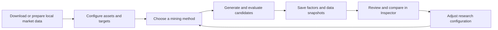

[简体中文](FactorMiner_Product_Report_ZH.md) · [English documentation](README.en.md)

# FactorMiner V4 Product Overview and Installation Guide

Version: 4.0.0 | Updated: November 25, 2026 | Audience: quantitative researchers, algorithm engineers, and project maintainers

FactorMiner is a quantitative factor research workbench that runs locally. It connects historical market data, factor generation, shared scoring, result archiving, and human review, so researchers can start experiments from configuration files and trace each candidate's logic, data provenance, and evaluation results.

The current main data pipeline handles crypto-asset OHLCV data through a Python CLI, FastAPI backend, and React Web interface. The release scope is a local, single-user research environment run from a source checkout. This guide describes implemented capabilities; planned items in the requirements documents are labeled separately.

## Reading Order

- To understand the product, read “Product Features” and “Mining Methods and Use Cases.”
- For your first run, follow “Installation,” “Starting the Services,” and “Your First Research Workflow” in order.
- To customize research, read “Configuration,” “LLM Configuration,” and “User Extensions.”
- For troubleshooting or project handover, read “File Management and Operation,” “Common Questions,” and “Validation and Current Limits.”

## Product Features

The research workflow is:



| Feature | Current capabilities | Entry point |
| --- | --- | --- |
| Historical market data management | Download, paginate, merge, fill gaps, run health checks, and save Feather files; inspect local data coverage | Data Center, `factorminer download` |
| Multi-asset research | Mine each asset independently, or align multiple assets into cross-sectional matrices for joint computation | `data_feeds.mining_mode` |
| Multiple candidate generation methods | Generate candidates with formula search, probability-based policy updates, neural networks, or an LLM | Launchpad, `factorminer mine` |
| Shared targets | Configure the entry price, holding horizon in bars, and simple or log forward returns | Top-level `target` |
| Metrics and custom scoring | Calculate IC, RankIC, and factor-value change metrics; integrate a Fitness Hook | Shared evaluator |
| Task monitoring | Display task status, logs, progress, and evaluation scatter points; replay in-memory task states when the connection recovers | Launchpad, WebSocket |
| Research overview | View factor inventory, Miner distribution, lifecycle labels, recent tasks, and high-scoring candidates | Dashboard |
| Factor review | Inspect logic, metrics, provenance, data lineage, rolling IC, quantile returns, and turnover diagnostics; compare 2–5 factors with snapshots | Web Inspector |
| CLI reevaluation | Recalculate metrics for selected assets and intervals from a factor ID, AST, or Python factor code | `factorminer inspect` |
| Local archives | Save metadata, formulas or source code, factor/forward-return snapshots, and restorable NN artifacts | `factor_db/` |
| User extensions | Register Miners, unary or binary operators, Fitness Hooks, and model loaders | `user_workspace/` |
| Research assistance Skill | Turn research ideas into hypotheses, features, targets, data splits, and evaluation plans | [FactorMiner Skills](../skills/README.en.md) |

### The Four Web Pages

| Page | Route | Main actions |
| --- | --- | --- |
| Dashboard | `/` | View research summaries, enter factor details or the task list, then open task details |
| Mining Launchpad | `/launchpad` | Select a registered Miner and JSON configuration, start mining, and view status, logs, and results |
| Factor Inspector | `/inspector` | Browse factor records, analyze snapshots, compare candidates, and update lifecycle states individually or in bulk |
| Data Center | `/data` | Choose exchange, market, pairs, timeframes, and dates; check coverage and download data |

Data Center currently offers Binance and OKX. The CLI accepts exchange names supported by CCXT; available symbols, markets, and timeframes still depend on the exchange API and downloader support. Prefer covered fixed-duration timeframes such as 1m, 5m, 15m, 1h, 4h, and 1d.

Web supports multiple pairs and timeframes, with one market type per selection. Download combinations within a batch run sequentially in the background; separate tasks can run concurrently. The coverage table shows each local file's start time, end time, and row count. These bounds alone do not prove that the interval is gap-free. Launchpad's scatter plot records each iteration's best candidate IC and its actual complexity when available. Color represents complexity, not lineage or trading returns.

The interface offers Chinese, English, and German, currently covering global navigation, Dashboard, and Inspector. Some pages and logs retain their original language. Factor IDs, expressions, trading pairs, and metric names in research artifacts remain unchanged.

## Mining Methods and Use Cases

| Method | Recommended entry point | Current implementation and use cases |
| --- | --- | --- |
| GP formula search | `MyCustomGP` | Random expression trees, mutation, and elite retention for readable formula search; built-in `GP` offers a simpler tree search |
| RL reference method | `MyCustomRL` | Updates operator and field sampling weights from candidate scores, useful for studying changes in search preferences |
| NN neural networks | `NN` or `MyCustomNN` | Uses a NumPy MLP by default, trains a model, and saves output channels as separate factors with weights and standardization parameters |
| LLM code generation | `MyCustomLLM` | Generates factor code through a Chat Completions-compatible API, continues searching from feedback, and can record the full experiment process |

Several names need to be distinguished:

- Built-in `RL` remains a skeleton with random trajectories and a placeholder policy update. Use `MyCustomRL` for reference experiments; it should not be described as a complete Actor-Critic system.
- `NN` and `MyCustomNN` are registered to the same reference implementation. The old `DL` name is deprecated; use `NN` in new configurations.
- `MyCustomGP` currently relies primarily on mutation and elite retention; this does not establish support for a full range of crossover strategies.
- `AdvancedSampleGP`, `MyTemporalNN`, and other research models in the workspace are extensions. Configure them according to their own implementations. This guide's introductory workflow uses `MyCustomGP`.

### Understanding Scores

`IC` is the Pearson correlation between factor values and forward returns; `RankIC` is Spearman rank correlation. Sequential single-asset mode calculates time-series correlation. Cross-asset mode calculates cross-sectional correlation at each timestamp, then averages it.

In the current shared evaluator, `Turnover` is the mean absolute change in factor values over time, not the executed turnover of a trading account. The default `fitness_score` is `abs(RankIC) × 100`, with a quadratic penalty when factor coverage is below 20%. Negative RankIC can also score highly, so check the factor's direction as well.

A Fitness Hook can replace the default score. Finite zero and negative scores are valid; a main score that is NaN, Infinity, or missing fails the candidate. Additional diagnostic values retain their original values in the archive. Nonfinite values become `null` in HTTP/WS transport, and the page marks them unavailable.

CLI Inspector's IR currently uses a fixed `sqrt(252)` scale, without adjustment for bar frequency or the crypto trading calendar. Its t-stat and positive-IC share are correlation diagnostics, not a trade win rate or an independent significance conclusion. Default decay analysis uses Lag 1, 2, 3, 5, and 10. Mean forward returns by quantile also do not represent a strategy equity curve after fees and slippage.

### Mining and Test Intervals

`mine_period` defines mining or training data, while `test_period` supplies another interval. Specifying the latter alone does not make every Miner automatically perform an independent test:

- Shared evaluation for GP, the reference RL, and ordinary LLM mining uses the mining interval by default. Use Inspector or the appropriate research tools to reevaluate a later interval separately.
- `MyCustomNN` trains on the mining interval and selects channels using the test interval when test data is available; otherwise it uses the training interval. Because the test interval participates in selection, it serves as a validation set in the research design. Final conclusions still require separate data that has not participated in selection.
- Targets are constructed independently for each requested interval. Samples at the end without enough future prices remain missing; they do not borrow prices from the next interval.

## Installation

### Prepare the Environment

| Item | Configuration used in this guide |
| --- | --- |
| Python | 3.10 or later; tested with 3.12, which the commands below use |
| Node.js | 22.12 or later, with the npm distributed with Node |
| Operating system | The commands below use a macOS or Linux shell; existing validation was performed on macOS |
| GPU | Introductory GP, the reference RL, and the default NumPy NN do not require a GPU |
| Network | Dependency installation, market data downloads, and live LLM calls require access to their services; ordinary factor computation can run offline with complete local data |

Memory and disk requirements depend on asset count, bar count, model, and concurrency. Start with one asset, a 1h timeframe, a small population, and a few iterations before increasing scale.

### Install the Backend and CLI Entry Point

Obtain the source and enter the project root. If you already have a checkout, enter that directory instead:

```bash
git clone https://github.com/CharlesJ-ABu/FactorMiner.git
cd FactorMiner
python3.12 -m venv .venv
source .venv/bin/activate
python -m pip install -e '.[test]'
factorminer --help
```

`.[test]` installs core runtime and test dependencies. To use the product without tests, run `python -m pip install -e .`. `requirements.txt` retains a broader collection of extension/research dependencies. If you need those tools, use the following installation path, including the test extra when needed:

```bash
python -m pip install -r requirements.txt
python -m pip install -e '.[test]'
```

The wheel provides the Python engine, CLI, and API modules. The workspace, example configurations, and frontend come from the source checkout; the wheel does not contain a complete runnable website. The workflow here always starts from the source root. Python dependencies use compatible version ranges, so the exact environment can vary with dependency resolution. When transferring research, retain the source revision, dependency versions, and input data used.

### Install the Frontend

From the project root, run:

```bash
cd web
npm ci
```

The repository includes `package-lock.json`; `npm ci` installs from that lockfile. CLI-only users can skip frontend installation and startup.

### Extension Dependencies

The default NumPy NN does not require PyTorch. If a model you add imports `torch` directly, install it separately in the same Python environment:

```bash
python -m pip install torch
```

Dynamic loading scans Python files under the workspace's `custom_miners`, `custom_operators`, and `custom_fitness`. Any import failure blocks mining startup. New extensions should declare their own extra dependencies. The first CLI workflow below uses a separate extension directory containing only GP. Web uses the full `user_workspace`; after starting the backend, confirm that `/api/miners` returns `load_errors: []`. Even an unselected Miner's scanned module must have its import dependencies satisfied.

## Starting the Services

### Terminal One: Start the Backend

Run from the source root:

```bash
source .venv/bin/activate
python -m uvicorn api.main:app --host 127.0.0.1 --port 8000
```

Open `http://localhost:8000/docs` to inspect the REST API. To check health:

```bash
curl http://localhost:8000/api/health
```

The normal response is:

```json
{"status":"ok","engine":"FactorMinerDirector"}
```

This response only shows that the API can respond; it does not establish that market data, Miners, and LLM credentials are ready. You may add `--reload` during development. A restart caused by code changes interrupts current in-memory tasks.

### Terminal Two: Start the Frontend

Open another terminal, enter the source root, then run:

```bash
cd web
npm run dev -- --host 127.0.0.1 --port 5173 --strictPort
```

Open `http://localhost:5173`. The frontend currently uses fixed addresses `http://localhost:8000` and `ws://localhost:8000/ws/monitor`, so keep these ports initially. Remote access also requires changes to frontend API/WS addresses, proxy configuration, and access control; this installation workflow is for local use.

Build the frontend with `npm run build`; output is written to `web/dist/`. Use `npm run preview` to inspect the build locally. A successful build alone does not constitute remote service deployment.

## Your First Research Workflow

This example uses BTC perpetual futures, 1h bars, and two GP iterations. It introduces the workflow and artifacts without assuming that any factor will produce useful returns.

### Download Market Data

Return to the project root and activate the Python environment:

```bash
factorminer download \
  --exchange binance \
  --symbols 'BTC/USDT:USDT' \
  --timeframes 1h \
  --type futures \
  --start 2024-01-01 \
  --end 2024-01-11 \
  --mode full
```

The download interval is UTC `[start, end)`, excluding January 11 in this example. A complete interval contains 240 hourly bars, saved to:

```text
data/binance/futures/BTC_USDT_USDT-1h-futures.feather
```

For spot, use `BTC/USDT` and `--type spot`. Both `/` and `:` in the symbol become `_`; the directory also separates exchanges and market types.

CLI `full` and `incremental` currently both use the merge-save path. Specify the desired dates explicitly; `incremental` does not automatically locate the last bar and resume from there. `overwrite` replaces the old file's interval; use it only when you intend to rebuild the file. Web also provides a gap-filling mode.

### Save the Introductory Configuration

Save the following as `user_workspace/configs/product_quickstart.json`. This filename is an example for this guide, and you need to create it yourself; do not overwrite an existing experiment configuration.

```json
{
  "population_size": 12,
  "max_iterations": 2,
  "data_feeds": {
    "exchange": "binance",
    "instrument_type": "futures",
    "timeframe": "1h",
    "pairs": ["BTC/USDT:USDT"],
    "required_streams": ["close", "volume"],
    "mine_period": [["2024-01-01 00:00:00", "2024-01-07 23:00:00"]],
    "test_period": [["2024-01-08 00:00:00", "2024-01-10 23:00:00"]],
    "mining_mode": "sequential_single"
  },
  "target": {
    "type": "forward_return",
    "entry_price": "current_close",
    "exit_price": "close",
    "horizon_bars": 1,
    "return_type": "simple"
  },
  "search_space": {
    "allowed_operators": ["add", "sub", "mul", "div", "ts_mean", "ts_std"]
  },
  "evaluation": {
    "max_workers": 2
  }
}
```

Mining intervals include both the first and last bars, so the last day's `23:00:00` is explicit here. Writing only `2024-01-07` means 00:00 that day, not the whole day. This example omits `fitness.hook` and uses the default score.

### Start Mining

For your first CLI run, prepare an extension directory containing only the reference GP, working from the project root. The example configuration explicitly uses built-in operators, so no other operator or fitness files need to be copied:

```bash
mkdir -p user_workspace/quickstart_extensions/custom_miners
cp user_workspace/custom_miners/my_custom_gp.py user_workspace/quickstart_extensions/custom_miners/
```

Then run:

```bash
factorminer mine \
  --miner MyCustomGP \
  --config user_workspace/configs/product_quickstart.json \
  --user-dir user_workspace/quickstart_extensions
```

For Web, first confirm that the full workspace's `load_errors` is empty. Refresh Launchpad, select `MyCustomGP` and `product_quickstart.json`, start mining, and open the task to view logs and results. Web always reads `user_workspace/configs/` and loads the full workspace; it does not use the CLI extension directory above. It provides configuration selection; changing parameters still requires editing the JSON file.

CLI `--miner`, or the Miner selected in Web, determines the actual algorithm and overrides `paradigm` in the configuration. CLI `--iterations` can temporarily override `max_iterations`.

### Review and Reevaluate Results

Successful results provide `fac_...` factor IDs. Open Inspector to view logic, original metrics, and snapshots. A completed task does not imply that a useful factor was found. `completed_empty` means execution ended without results that could be archived.

Replace `fac_REPLACE_WITH_REAL_ID` below with an actual ID from this run, then reevaluate the later interval:

```bash
factorminer inspect \
  --factor fac_REPLACE_WITH_REAL_ID \
  --config user_workspace/configs/product_quickstart.json \
  --pairs 'BTC/USDT:USDT' \
  --timeframe 1h \
  --start '2024-01-08 00:00:00' \
  --end '2024-01-10 23:00:00' \
  --user-dir user_workspace/quickstart_extensions
```

Both `--start` and `--end` must be supplied to override the configured interval. The CLI also accepts `--ast` and `--code`; choose one factor source per invocation. CLI reevaluation currently explicitly rejects cross-asset NNs. View their stored Web snapshots, or supply the model's full required matrix through the Python Resolver.

## Configuration

### Common Parameters

| Field | Meaning and considerations |
| --- | --- |
| `population_size` | Candidate generation size, with the exact meaning defined by the Miner; do not assume that one NN model equals one factor |
| `max_iterations` | Outer search or training iterations; the CLI uses 5 when neither this field nor an override is supplied |
| `data_feeds.exchange` | Source exchange; must match the local data directory |
| `instrument_type` | Market type; use `spot` or `futures` for the introductory workflow |
| `timeframe` | Bar interval; must match the filename |
| `pairs` | Actual research assets; perpetuals use CCXT symbols including the settlement currency |
| `required_streams` | Candidate terminals, model features, or LLM prompt fields for the reference Miners, such as close and volume; this is not a global data-access allowlist, and the reader may retain other market data columns |
| `mine_period` / `test_period` | Lists of intervals, interpreted in UTC, with the final bar included in each slice |
| `mining_mode` | Only `sequential_single` or `cross_asset`; defaults to the former when omitted, and misspellings fail |
| `search_space.allowed_operators` | Built-in or registered operator names; unknown names are rejected at startup |
| `fitness.hook` | Registered scoring function name; omission uses the default score, while a misspelling does not silently fall back |
| `evaluation.max_workers` | Candidate evaluation threads; defaults to 8, allows 1–64, and can be set to 2 for a first run |

`sequential_single` processes assets one by one and suits single-asset time-series factors. `cross_asset` aligns assets and processes them together, requiring operators, scoring functions, and models that support time × asset data. Switching modes changes the research object and the meaning of correlation, not merely the degree of parallelism.

### Forward-Return Targets

| Field | Currently supported values |
| --- | --- |
| `type` | `forward_return` |
| `entry_price` | `current_close`, `next_open` |
| `exit_price` | `close` |
| `horizon_bars` | A positive integer, measured in bars |
| `return_type` | `simple`, `log` |

The default target is `close[t+1] / close[t] - 1`. With `next_open`, `horizon_bars=3`, and simple returns, the formula is `close[t+3] / open[t+1] - 1`. Market data must contain an `open` column, but it does not need to be a model input feature. The target definition is saved with the record; Inspector can inherit it or override it explicitly. Results with different target definitions should not be treated as the same experiment.

### NN Configuration

Start by copying `user_workspace/configs/configNN.json` and adjusting the data intervals. Main parameters include `hidden_dim`, `learning_rate`, `random_seed`, `nn_training_epochs`, `nn_min_samples`, `nn_l2`, `nn_diversity_penalty`, `nn_gradient_clip`, `nn_early_stopping_patience`, `top_k_factors`, and `max_corr`.

`nn_training_epochs` is the maximum number of training epochs per outer iteration. Training may stop early based on training loss; this is a different budget from `max_iterations`. `hidden_dim` determines the number of channels that can become factors. By default, models are stored in `factor_db/models/` and channel metadata in `factor_db/metadata/`. Restoration requires the complete artifact and the same input definition.

After confirming that the configured data is ready, run:

```bash
factorminer mine --miner NN --config user_workspace/configs/configNN.json --user-dir user_workspace
```

### LLM Configuration

Install the core dependencies above first; the API client requires `aiohttp`.

The reference configuration is `user_workspace/configs/configLLM_experiment.json`. It reads `AI_API_KEY` or `OPENAI_API_KEY` from the environment, and allows `AI_MODEL` and `AI_API_BASE` to override the model and service address.

Set environment variables in the same terminal that starts the CLI or backend. Replace the model and address below with those for your actual service. `read` waits for the key without echoing it:

```bash
read -r -s AI_API_KEY
export AI_API_KEY
export AI_MODEL='REPLACE_WITH_AN_ENABLED_MODEL_ID'
export AI_API_BASE='https://REPLACE_WITH_SERVICE_ADDRESS/v1'
```

The current implementation reads these values from the process environment; creating a `.env` file alone does not load them. For Web use, restart the backend after setting the environment.

For live experiments, keep `experiment.require_live_api=true` and `experiment.allow_fallback=false`: missing credentials block startup, failed requests do not generate fallback candidates, and a batch with no usable responses fails the task. Other valid responses in the batch can still be processed. `max_concurrency`, `max_retries`, and `timeout_seconds` control request behavior. Model costs depend on the provider and actual usage.

After checking the template's data intervals, model, and call budget, start with:

```bash
factorminer mine --miner MyCustomLLM --config user_workspace/configs/configLLM_experiment.json --user-dir user_workspace
```

`llm_sandbox` defaults to a 5-second wall-clock timeout, a cumulative 3-second CPU budget, and a configured memory limit of 1024 MiB. Actual resource-limit support depends on the operating system. Generated code is restricted by a syntax/API allowlist and execution in a separate process. Custom extension files are imported in the main process, so load only trusted extensions.

Enable `experiment.record_dir` to save requests, raw responses, candidate results, and reevaluation records. See the [Custom LLM and Experiment Recording Guide](guides/custom_llm_experiments.en.md) for details. Prompts and responses may contain research material; store them according to your research-data requirements.

## User Extensions

Extensions live in dedicated directories and do not require changes to core scheduling:

| Extension | Directory | Current registration method |
| --- | --- | --- |
| Miner | `user_workspace/custom_miners/` | Inherit `BaseFactorMiner` and use `@MinerRegistry.register("name")` |
| Operator | `user_workspace/custom_operators/` | Use `@OperatorRegistry.register(arity=1)`, or `2` for a binary operator |
| Scoring | `user_workspace/custom_fitness/` | Use `@EvaluatorRegistry.register_fitness_hook("name")` |
| Restorable NN model | Custom model module | Use `register_nn_model_loader(model_format, loader)` |

A Fitness Hook has the signature `hook(factor_values, returns, base_metrics)` and returns a finite number or a dictionary with a finite `fitness_score`. It replaces the default score. Include coverage or other penalties explicitly in your function if you need them.

Operator and factor outputs must preserve the input index, asset columns, and dimensions; they should not silently sort, fill with zero, or change targets. Ordinary code factors return a `pandas.Series` or `pandas.DataFrame`. Model extensions must account for training, channel prediction, and artifact restoration together. Saving a weights file alone does not guarantee reproducibility in another environment.

## File Management and Operation

| Path | Stored content |
| --- | --- |
| `data/<exchange>/<market>/` | Raw/merged Feather market data |
| `user_workspace/configs/` | JSON research configurations |
| `config/user_config/config.json` | Exchange account configuration, created on the first actual save; may contain credentials |
| `factor_db/metadata/` | Factor IDs, logic references, metrics, lifecycle, and data lineage |
| `factor_db/values/` | Aligned factor values and forward returns in parquet snapshots |
| `factor_db/sources/` | Source code and related records for code factors |
| `factor_db/models/` | Restorable NN model artifacts |
| `factor_db/weights/` | Legacy or implementation-specific weights files |
| `user_workspace/experiments/` | Additional research process files when the Recorder is enabled |

Start both the backend and CLI from the project root, because data and archive paths resolve relative to the current working directory. The public entry points currently use local `factor_db/` through `get_global_storage()`. Although some configurations contain `storage.db_root`, it is not wired through those entry points; changing it is not an implemented database-switching feature.

Metadata retains parent references declared by the Miner and the LLM model provenance. Parent references are not guaranteed to be resolvable IDs of archived factors. These records are also not a complete search-state or RL-policy checkpoint. NN restoration depends on the full model artifact, its loader, and the same input definition.

Exchange account configuration is always written to the working directory, including with a wheel installation; it is not written into site-packages. Writes use a private temporary file and atomic replacement, with new POSIX files assigned mode 0600. Protect configurations containing credentials separately and exclude them from public source releases.

Back up research configurations, extension code, market data, and the whole `factor_db/` together. Copying metadata alone can lose source code, models, or snapshots. Restarting the service loses the in-memory task list and download states, but does not delete archived factor records.

The current design suits a single backend process. Download threads within that process coordinate merges by file path. Multiple processes or machines writing to the same data directory are outside this protection.

If a candidate's snapshot fails, diagnostic metadata is retained, and `pending` / `failed` records cannot be analyzed. Other candidates in the same batch continue, and completed records are preserved. The CLI exits with failure, with successful and failed IDs listed in local logs. Web reports failure and redacts public error messages. Older records are read using their existing snapshots.

Lifecycle values include `DISCOVERED`, `INSPECTED`, `PAPER_TRADING`, `LIVE`, and `RETIRED`. These are human-managed labels; changing a label does not start a simulated account or live trading.

## Common Questions

| Symptom | What to check first |
| --- | --- |
| `factorminer: command not found` | Activate the correct environment and run `python -m pip install -e .`; alternatively use `python -m core.cli` |
| Web opens but shows no data | Check whether the backend on port 8000 is reachable, whether the frontend's fixed address still matches, and browser request errors |
| Missing Miners or import failures at startup | Inspect `/api/miners` `load_errors`; check extension directories and additional dependencies |
| Market data cannot be found or automatic downloading starts | Check consistency of the working directory, exchange, market, CCXT symbol, timeframe, and filename |
| Data appears to exist but the interval is empty | Check UTC handling, the interval's end timestamp, requested range, and actual file coverage |
| Download reaches 100% but the task fails | Use the terminal state completed / failed / partial_failed and individual errors; percentage alone does not establish success |
| Task records disappear after a restart | Tasks exist only in memory; find archived factors in Inspector |
| Inspector has no analysis charts | Confirm that the factor has a values snapshot; old records do not get fabricated historical curves |
| An old NN model cannot be restored | Check artifacts, model_format registration, and feature definitions; bare legacy weights cannot be restored by guessing |
| LLM sends no requests or reports credential errors | Check the same process's environment, placeholder keys, aiohttp, model permissions, service address, and experiment mode |
| Many scores are zero | Check for constant inputs, effective sample size, targets, the Hook, and backend version; do not assume zero is a normal research result |

<a id="validation-and-current-limits"></a>

## Validation and Current Limits

On November 25, 2026, source installation and the public test set were verified in a fresh Python 3.12 environment on macOS. Python had 322 passing tests, plus 10 passing subtests. Under Node 22.23.2, all 31 Web tests passed, lockfile installation succeeded, and the production build succeeded. Browser checks opened the home page, Launchpad, Data Center, and Inspector, and rendered factor charts produced from synthetic market data. Exchange metadata came from test fixtures. The following commands can be rerun on later versions.

After installing `.[test]` in a fresh source checkout, run the complete product tests from the root:

```bash
python -m pytest -q tests
cd web
npm ci
npm test
npm run build
```

If your workspace also contains private research tests, use this fixed core set of 15 files from the root:

```bash
python -m pytest -q \
  tests/test_cli_smoke.py tests/test_data_gap_repair.py tests/test_data_naming.py \
  tests/test_download_integrity_round2.py tests/test_download_status_round2.py \
  tests/test_factor_analytics.py tests/test_inspector_review_round2.py \
  tests/test_llm_api_manager.py tests/test_llm_guardrails.py \
  tests/test_missing_target_semantics.py tests/test_nn_miner.py \
  tests/test_operator_runtime.py tests/test_source_review_core.py \
  tests/test_targets.py tests/test_task_execution.py
```

Core tests use synthetic data, temporary archives, and substitutes for external interfaces. They cover download completeness and concurrent merging, mode validation, metrics/model restoration, failure propagation, and Web state. Web tests check controlled events in components and hooks, while the build checks TypeScript and static artifacts. None of these substitutes for validation against real networks, trading, or installation on a new machine.

Keep the following limits in mind:

- The core currently provides factor research and management. It does not include a validated live-order system, account risk controls, or a complete backtest incorporating fees, slippage, and funding rates. Factor correlation does not establish trading profitability.
- General deduplication primarily uses source-code hashes. The reference NN also filters by candidate output correlation; this is not a shared semantic deduplication mechanism for all Miners.
- Evaluation uses a local thread pool; complete Ray/Celery distributed execution is not integrated.
- The current API does not have a complete user-authentication or multi-tenant permissions system. The installation workflow binds to the local machine.
- Code-execution restrictions do not replace research review for look-ahead bias, overfitting, and independent samples. Data Center shows file time bounds; evaluator Coverage uses valid factor outputs, while CLI Inspector Coverage uses jointly valid factors and targets. Cross-asset and single-asset denominators differ and cannot be used interchangeably. See the [Fitness Hook Guide](fitness_hook_guideline.en.md).
- Web Inspector uses stored snapshots, while CLI Inspector reevaluates each asset separately. Quantile returns are not yet implemented in the underlying cross-asset metrics entry point. Missing groups are unavailable, not zero-return groups.
- Existing Web tests validate controlled events. Real browser network interruptions, multi-process writes, and recovery after service restart are outside the conclusions established by those passing tests.

Maintainers can recheck the documented interfaces in an existing environment:

```bash
python -m core.cli --help
python -m core.cli mine --help
python -m core.cli download --help
python -m core.cli inspect --help
```

Tests do not automatically establish a factor's economic value, and they do not cover every extension users may add. Before running private research tools, separately confirm their inputs, execution budget, and output scope.

## Maintenance References

- [Project README](../README.en.md): Project entry point and extension examples.
- [Architecture Design](architecture/v4_architecture_design.en.md): Module relationships and implemented contracts.
- [Product Requirements](FactorMiner_PRD.en.md): Product requirements and development direction.
- [CLI Definitions](../core/cli.py), [API Definitions](../api/main.py): Parameters and service interfaces.
- [Startup Validation](../core/startup_validation.py), [Target Implementation](../core/evaluation/targets.py), [Archive Implementation](../core/storage/factor_storage.py): The actual interpretation of configurations and artifacts.
